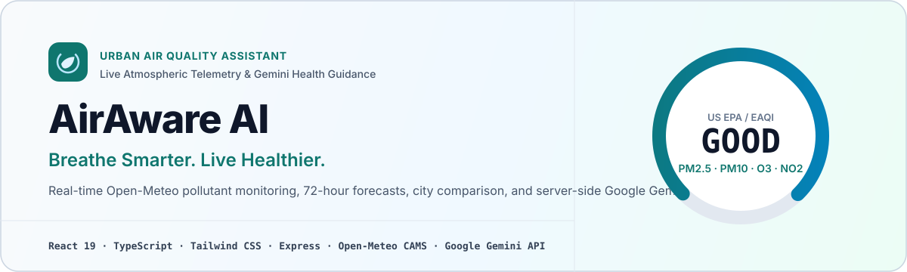
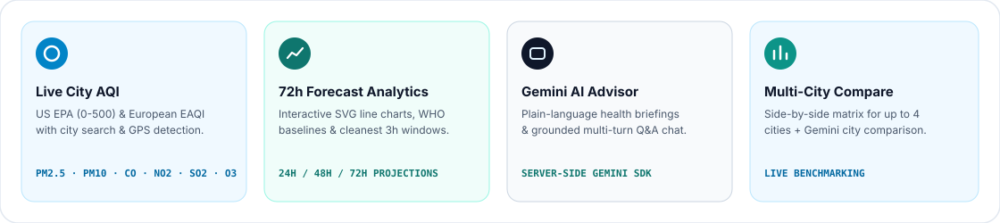
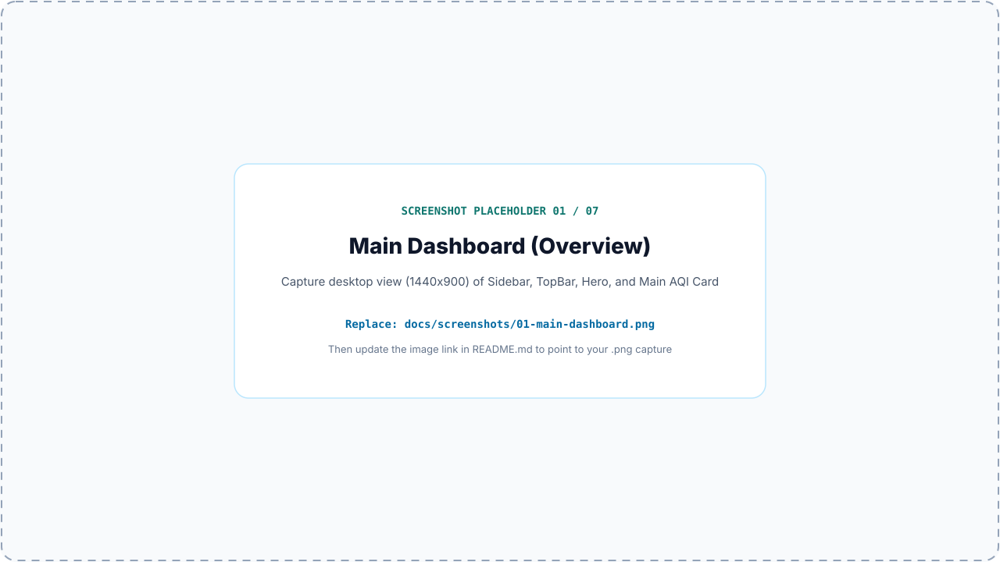
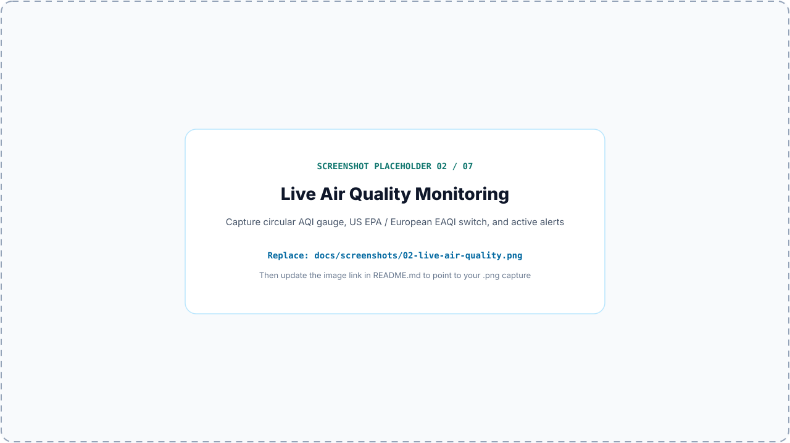
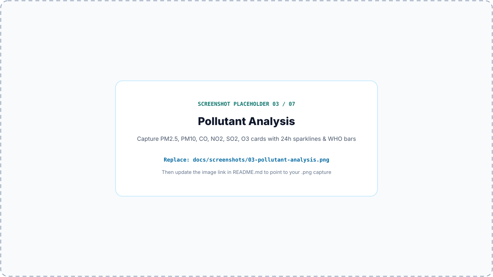
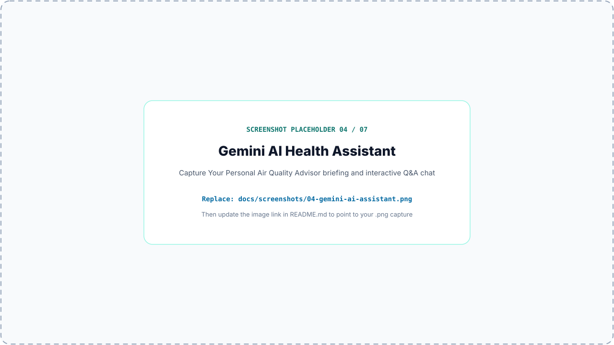
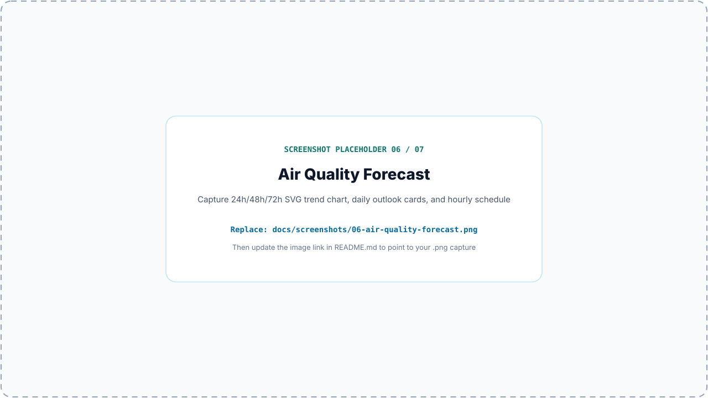
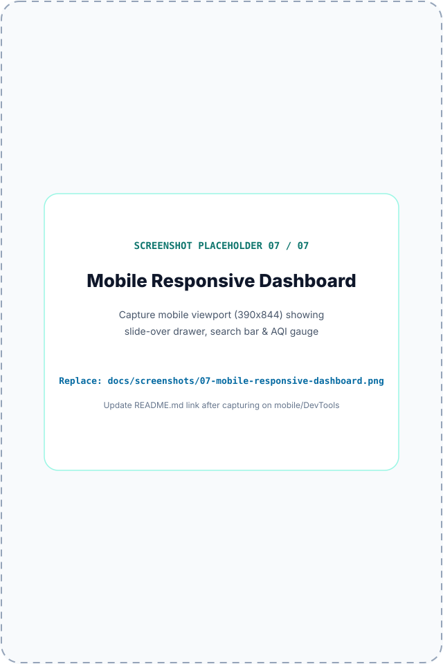
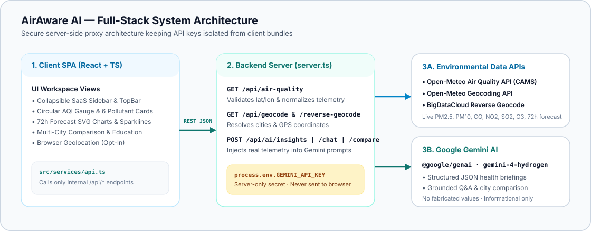

<div align="center">



<br />
<br />


<h3>Breathe Smarter. Live Healthier.</h3>

<p>
  <strong>AirAware AI</strong> is a full-stack environmental intelligence platform combining live urban air quality telemetry, 72-hour atmospheric forecasts, multi-city comparisons, and server-side Google Gemini AI health guidance.
</p>

<p>
  <a href="#-demo-video">Demo Video</a> ·
  <a href="#-screenshots-gallery">Screenshots</a> ·
  <a href="#-system-architecture">Architecture</a> ·
  <a href="#-installation--local-development">Local Setup</a> ·
  <a href="#-vercel-deployment">Vercel Deployment</a> ·
  <a href="#-license">License</a>
</p>

</div>

---

## Table of Contents

1. [Project Overview](#-project-overview)
2. [Problem Statement](#-problem-statement)
3. [Our AI-Powered Solution](#-our-ai-powered-solution)
4. [Main Features](#-main-features)
5. [Demo Video](#-demo-video)
6. [Screenshots Gallery](#-screenshots-gallery)
7. [Technologies & Tools Used](#-technologies--tools-used)
8. [Google Gemini AI Integration](#-google-gemini-ai-integration)
9. [Air Quality API Integration](#-air-quality-api-integration)
10. [System Architecture](#-system-architecture)
11. [Repository Structure](#-repository-structure)
12. [Installation & Local Development](#-installation--local-development)
13. [Environment Variable Setup](#-environment-variable-setup)
14. [Vercel Deployment](#-vercel-deployment)
15. [Security & Privacy](#-security--privacy)
16. [Future Improvements](#-future-improvements)
17. [Contributing](#-contributing)
18. [Data Source Attribution & Disclaimer](#-data-source-attribution--disclaimer)
19. [License](#-license)

---

## 🌍 Project Overview

**AirAware AI** (*Urban Air Quality Assistant*) transforms raw atmospheric pollutant numbers into clear, personalized, and actionable environmental health guidance. Built with React 19, TypeScript, Tailwind CSS v4, Express, the Open-Meteo Air Quality API (Copernicus CAMS), and Google Gemini (`@google/genai`), the platform empowers residents, runners, commuters, parents, and sensitive groups to understand the air they breathe in real time.

> **Live Deployment:** Deployed on **Vercel** — replace this note with your public Vercel URL (`https://your-airaware-ai.vercel.app`) before final hackathon submission.

---

## ⚠️ Problem Statement

Urban air pollution is one of the most pressing yet misunderstood daily environmental health risks:

- **Opaque Numeric Indices:** Most weather widgets show a single AQI number without explaining *which* pollutant (`PM2.5`, `O3`, `NO2`, `PM10`, `SO2`, `CO`) is driving the score or what concentration is safe.
- **Standard Confusion:** Different regions use incompatible AQI scales (**US EPA AQI 0–500** vs. **European EAQI 0–100+**), leaving residents unsure how readings compare globally.
- **No Actionable Timing:** People need to know *when* to open windows, *whether* to run outdoors, and *what* precautions sensitive groups (children, older adults, asthma patients) should take based on upcoming hourly shifts.
- **Generic Advice:** Static tips ignore live city conditions, while client-side AI prototypes risk exposing API keys or fabricating measurements.

---

## 💡 Our AI-Powered Solution

**AirAware AI** solves these gaps through a clean, telemetry-first SaaS dashboard backed by real atmospheric data and grounded server-side AI:

<div align="center">
  
</div>

1. **Real-Time Telemetry First:** Fetches live pollutant concentrations and 72-hour hourly forecasts for any searched city or GPS location via Open-Meteo's Copernicus CAMS models.
2. **Grounded Gemini AI Advisor:** Passes exact retrieved readings, units (`µg/m³`), timestamps, and 24-hour forecast bounds to Google Gemini (`gemini-4-hydrogen`) on the backend—producing plain-language briefings and multi-turn Q&A without ever inventing numbers or issuing medical diagnoses.
3. **Interactive Visual Analytics:** Pairs a circular color-coded AQI gauge with 24h pollutant sparklines, WHO 2021 guideline comparison bars, 3-day outlook cards, and cleanest 3-hour ventilation windows.

---

## ✨ Main Features

- **Collapsible SaaS Workspace:** Responsive desktop sidebar and mobile slide-over navigation across **Overview**, **Live Air Quality**, **City Comparison**, **Forecast & Trends**, **AI Health Assistant**, **Pollution Insights**, and **Settings**.
- **Global City Search & Opt-In GPS Location:** Debounced autocomplete city search via Open-Meteo Geocoding plus browser geolocation (`navigator.geolocation`) with reverse locality lookup.
- **Circular AQI Centerpiece & Dual Standards:** Color-coded radial AQI gauge supporting seamless switching between **US EPA AQI (0–500)** and **European EAQI (0–100+)**, complete with an expandable health threshold scale table.
- **6 Dedicated Pollutant Telemetry Cards:** Real-time readouts for `PM2.5`, `PM10`, `CO`, `NO2`, `SO2`, and `O3` in `µg/m³`, WHO 2021 guideline status tags, progress bars, and 24-hour SVG sparklines.
- **72-Hour Forecast & Pollutant Analytics:** Interactive SVG line chart (`24h` / `48h` / `72h`) with hover crosshair inspection, WHO/EPA reference lines, normalized WHO load comparison chart, 3-day daily summaries, and a 24-hour hourly table.
- **"Your Personal Air Quality Advisor" (Gemini AI):** Generates structured JSON health briefings (headline, plain-language summary, dominant pollutant explanation, general precautions, sensitive group guidance, and action steps) alongside an interactive Q&A chat.
- **5-Category Health & Clean-Air Recommendations:** Dynamic guidance cards covering outdoor exercise, N95/FFP2 mask advisories, indoor ventilation/HEPA tips, sensitive groups, and emission reduction actions.
- **Multi-City Comparison:** Compare up to 4 global cities side-by-side in visual bar rankings, tabular matrices, and Gemini AI comparative synthesis.
- **Pollution Insights & Education:** Interactive pollutant encyclopedia detailing urban emission sources, respiratory pathways, and WHO 2021 vs. EPA/EAQI standards.
- **Resilient Error & Opt-In Demo Mode:** Skeleton loading states, input validation, explicit API error banners, and a clearly labeled opt-in Demo Snapshot mode only if live upstream services are unreachable.

---

## 🎥 Demo Video

> **Placeholder Notice:** No recorded demo video file is committed to this repository (keeping the repo lightweight and under 10 MB). Upload your walkthrough to **YouTube** (Unlisted or Public) or **Google Drive**, then replace the link and thumbnail below.

<div align="center">
  <a href="https://www.youtube.com/watch?v=YOUR_VIDEO_ID">
    
  </a>
  <p>
    <strong>Watch the Full Walkthrough:</strong>
    <a href="https://www.youtube.com/watch?v=YOUR_VIDEO_ID">https://www.youtube.com/watch?v=YOUR_VIDEO_ID</a>
    <em>(Replace with your YouTube demo link)</em>
  </p>
</div>

### Demo Video Description
A 3-minute walkthrough demonstrating live urban air quality monitoring in AirAware AI—searching global cities, switching between US EPA and European AQI standards, inspecting 72-hour pollutant forecasts, comparing multiple cities, and querying the server-side Gemini AI Health Advisor.

### Key Timestamps (Template)
- `00:00` — Problem overview & AirAware AI dashboard introduction
- `00:35` — Live city search, GPS location detection & circular AQI gauge
- `01:10` — Individual pollutant cards (`PM2.5`, `PM10`, `CO`, `NO2`, `SO2`, `O3`) & WHO bars
- `01:45` — 72-hour forecast charts & cleanest ventilation window detection
- `02:15` — **Your Personal Air Quality Advisor**: Gemini AI briefing & live Q&A
- `02:45` — Multi-city comparison & mobile responsive layout

*How to update:* Record your screen (1080p), upload to YouTube, optionally export a `1280×720` cover image to `docs/assets/demo-thumbnail.png`, and replace `YOUR_VIDEO_ID` and the placeholder image path above.

---

## 📸 Screenshots Gallery

> **Placeholder Notice:** All images below currently point to clearly labeled SVG placeholders inside [`docs/screenshots/`](docs/screenshots/README.md). Capture real screenshots from your live Vercel deployment and replace each `.svg` file with your `.png` capture (see [`docs/screenshots/README.md`](docs/screenshots/README.md) for exact instructions).

### 1. Main Dashboard
*Overview workspace featuring the collapsible sidebar, TopBar search, welcome hero, and AQI centerpiece.*


### 2. Live Air Quality Monitoring
*Circular color-coded AQI gauge, US EPA / European EAQI toggle, dominant pollutant driver, and scale guide.*


### 3. Pollutant Analysis
*Individual cards for PM2.5, PM10, CO, NO2, SO2, and O3 with WHO threshold bars and 24-hour trajectory sparklines.*


### 4. Gemini AI Health Assistant
*"Your Personal Air Quality Advisor" providing grounded briefings, precautions, and interactive Q&A.*


### 5. City Comparison
*Side-by-side multi-city AQI rankings, pollutant matrix, and Gemini AI comparative summary.*


### 6. Air Quality Forecast
*Interactive 24h / 48h / 72h trend line chart, WHO baseline markers, 3-day outlook cards, and hourly schedule.*


### 7. Mobile Responsive Dashboard
*Mobile-first responsive layout with slide-over navigation drawer and touch-friendly controls.*


---

## 🛠 Technologies & Tools Used

| Layer | Technologies |
| :--- | :--- |
| **Frontend** | React 19 (`^19.0.1`), TypeScript (`^7.0.2`), Vite (`^8.3.0`), Tailwind CSS v4 (`@tailwindcss/vite`), Lucide React (`^0.546.0`), Motion (`^12.23.24`) |
| **Backend** | Node.js (v22+), Express (`^4.21.2`), `tsx` (`^4.21.0`), `dotenv` (`^17.2.3`) |
| **AI SDK** | `@google/genai` (`^3.4.0`) using model `gemini-4-hydrogen` |
| **Data & Geocoding APIs** | Open-Meteo Air Quality API (CAMS), Open-Meteo Geocoding API, BigDataCloud Reverse Geocoding API |
| **Deployment** | Vercel (Production Hosting) / Express + Vite Middleware (Local Full-Stack) |

---

## 🤖 Google Gemini AI Integration

AirAware AI integrates Google Gemini exclusively on the **server side** inside `server.ts` using the official `@google/genai` SDK (`gemini-4-hydrogen`):

- **`POST /api/ai/insights`:** Uses structured JSON output (`responseMimeType: "application/json"` with `Type.OBJECT` `responseSchema`) to generate:
  - Plain-language AQI headline & summary
  - Dominant pollutant explanation
  - General precautions, sensitive-group advice, and 3 actionable next steps
  - Explicit informational disclaimer
- **`POST /api/ai/chat`:** Powers multi-turn Q&A (`Ask Your Advisor`) with system instructions injecting the active city's exact retrieved pollutant values, units, and 24-hour min/max forecast summary.
- **`POST /api/ai/compare`:** Synthesizes side-by-side comparisons across selected cities.
- **Safety Guardrails:** Gemini is instructed never to fabricate live readings, always note unavailable fields honestly, and avoid issuing medical diagnoses or prescriptions. Upstream errors (e.g., missing key, 403, 429) propagate clearly to the UI without masking failures with fake text.

---

## 📡 Air Quality API Integration

AirAware AI queries real atmospheric telemetry through validated server-side proxy endpoints in `server.ts`:

- **Open-Meteo Air Quality API (`GET /api/air-quality?lat=...&lon=...`):**
  - Fetches `current`: `us_aqi`, `european_aqi`, `pm10`, `pm2_5`, `carbon_monoxide`, `nitrogen_dioxide`, `sulphur_dioxide`, `ozone`, `dust`, `uv_index`.
  - Fetches 3-day (`forecast_days=3`, `timezone=auto`) `hourly` series for forecast charts, sparklines, daily summaries, and cleanest 3-hour window detection.
- **Open-Meteo Geocoding API (`GET /api/geocode?q=...`):**
  - Resolves user city queries into verified latitude/longitude coordinates and timezones.
- **Reverse Geocoding (`GET /api/reverse-geocode?lat=...&lon=...`):**
  - Converts opt-in browser geolocation coordinates into readable city/country labels via BigDataCloud (with coordinate fallback if unavailable).

---

## 🏗 System Architecture

<div align="center">
  
</div>

1. **Client SPA (`src/`)**: Renders the responsive SaaS dashboard and communicates strictly with internal `/api/*` routes via `src/services/api.ts`.
2. **Express Backend (`server.ts`)**: Validates coordinates and search queries, fetches live Open-Meteo telemetry, invokes `@google/genai` using `process.env.GEMINI_API_KEY`, and serves Vite middlewares in development or compiled `dist/` assets in production.
3. **Zero Client Secret Exposure**: `GEMINI_API_KEY` never leaves the server environment.

---

## 📁 Repository Structure

```text
airaware-ai/
├── docs/
│   ├── assets/                        # Original SVG logo, banner, architecture & illustrations
│   │   ├── architecture.svg
│   │   ├── banner.svg
│   │   ├── demo-thumbnail-placeholder.svg
│   │   ├── features-overview.svg
│   │   └── logo.svg
│   └── screenshots/                   # Clearly labeled screenshot placeholders + capture guide
│       ├── 01-main-dashboard.svg
│       ├── 02-live-air-quality.svg
│       ├── 03-pollutant-analysis.svg
│       ├── 04-gemini-ai-assistant.svg
│       ├── 05-city-comparison.svg
│       ├── 06-air-quality-forecast.svg
│       ├── 07-mobile-responsive-dashboard.svg
│       └── README.md
├── src/
│   ├── components/
│   │   ├── AlertsAndActions.tsx       # Active pollution advisories & threshold alerts
│   │   ├── AnalyticsSection.tsx       # Trend chart + WHO pollutant bars + 3-day outlook
│   │   ├── AqiHeroCard.tsx            # Color-coded circular AQI gauge centerpiece
│   │   ├── CityComparisonWidget.tsx   # Overview global city benchmark strip
│   │   ├── CompareCitiesView.tsx      # Full 4-city interactive comparison view
│   │   ├── DashboardHero.tsx          # Welcome header, standard toggle & quick stations
│   │   ├── EducationView.tsx          # Pollutant encyclopedia & EPA/EAQI guide
│   │   ├── Footer.tsx                 # Attribution, privacy link & disclaimer
│   │   ├── ForecastChart.tsx          # Interactive 24h/48h/72h SVG time-series chart
│   │   ├── GeminiAssistant.tsx        # "Your Personal Air Quality Advisor" & Q&A chat
│   │   ├── HealthRecommendations.tsx  # 5 clean-air & protective guidance cards
│   │   ├── PollutantGrid.tsx          # 6 pollutant cards with 24h mini sparklines
│   │   ├── SettingsView.tsx           # Preferences, About, Privacy & Attribution
│   │   ├── Sidebar.tsx                # Collapsible desktop & mobile drawer navigation
│   │   └── TopBar.tsx                 # Search autocomplete, GPS, notifications & profile
│   ├── services/
│   │   └── api.ts                     # Typed frontend client for /api/* routes
│   ├── types/
│   │   └── airQuality.ts              # Shared TypeScript interfaces
│   ├── utils/
│   │   └── aqi.ts                     # EPA/EAQI scales, WHO guidelines & alert engine
│   ├── App.tsx                        # Main workspace state & view router
│   ├── index.css                      # Tailwind CSS v4 & typography styles
│   └── main.tsx                       # React entry point
├── .env.example                       # Environment variable template (no real secrets)
├── .gitignore                         # Excludes .env*, node_modules, dist, large videos
├── CONTRIBUTING.md                    # Open-source contribution guidelines
├── LICENSE                            # MIT License
├── SECURITY.md                        # Security & API key isolation policy
├── index.html                         # HTML shell & Google Fonts
├── metadata.json                      # Application metadata & permissions
├── package.json                       # Dependencies & npm scripts
├── server.ts                          # Express server (Open-Meteo proxy + Gemini AI)
├── tsconfig.json                      # TypeScript configuration
└── vite.config.ts                     # Vite configuration
```

---

## 💻 Installation & Local Development

### Prerequisites
- **Node.js** `v22.0.0` or higher (recommended: `v22+`)
- **npm** `v10+`
- A **Google Gemini API Key** (for AI Health Advisor features)

### Steps

1. **Clone the repository**
   ```bash
   git clone https://github.com/<your-username>/airaware-ai.git
   cd airaware-ai
   ```

2. **Install dependencies**
   ```bash
   npm install
   ```

3. **Configure environment variables** (see [Environment Variable Setup](#-environment-variable-setup))
   ```bash
   cp .env.example .env
   ```

4. **Start the full-stack development server** (runs Express API + Vite dev middleware on port `3000`)
   ```bash
   npm run dev
   ```
   Open [http://localhost:3000](http://localhost:3000) in your browser.

5. **Run type-check & production build**
   ```bash
   npm run lint
   npm run build
   ```

6. **Preview production server locally**
   ```bash
   NODE_ENV=production npm start
   ```

---

## 🔐 Environment Variable Setup

Create a `.env` file in the root directory (already ignored by `.gitignore`) based on [`.env.example`](.env.example):

| Variable | Required | Description |
| :--- | :--- | :--- |
| `GEMINI_API_KEY` | **Yes** (for AI endpoints) | Server-side Google Gemini API key. Never expose with `VITE_` prefix. |
| `PORT` | Optional | HTTP server port (defaults to `3000`). |
| `APP_URL` | Optional | Public deployment URL used for self-referencing metadata/links. |

Example `.env`:
```env
GEMINI_API_KEY="your_actual_gemini_api_key_here"
PORT=3000
APP_URL="http://localhost:3000"
```

---

## 🚀 Vercel Deployment

AirAware AI is ready for Vercel deployment with secure environment variables:

1. Push your repository to GitHub (confirm `.env` and `node_modules/` are **not** tracked).
2. Import the GitHub repository in the **Vercel Dashboard**.
3. Configure **Project Settings > Environment Variables**:
   - Add `GEMINI_API_KEY` with your Google Gemini API key (applied to Production, Preview, and Development).
   - Optionally add `APP_URL` set to your Vercel production domain.
4. Set **Build & Output Settings** according to your Vercel Node/Express or serverless configuration (`npm run build` compiles the React frontend into `dist/`, and `server.ts` serves both `/api/*` endpoints and static assets).
5. Trigger **Deploy** and verify live telemetry (`/api/air-quality`) and Gemini insights (`/api/ai/insights`) on your deployed URL.

---

## 🛡 Security & Privacy

- **Zero Exposed Secrets:** `GEMINI_API_KEY` is read exclusively in `server.ts`. Client bundles never import `@google/genai` or access secrets.
- **Git Hygiene:** `.gitignore` blocks `.env*`, `node_modules/`, `dist/`, `.vercel/`, and large video binaries (`*.mp4`, `*.mov`, `*.webm`) to keep the repository clean and well under 10 MB.
- **Opt-In Geolocation:** Location coordinates are only requested when the user clicks *My Location* / GPS detection and are never stored on any backend server.
- See [SECURITY.md](SECURITY.md) for full details.

---

## 🔭 Future Improvements

- Historical multi-month air quality trend comparisons and seasonal anomaly charts
- Saved favorite cities and browser push notifications for AQI threshold spikes
- Hyper-local sensor network integration (e.g., community IoT PM2.5 stations) alongside CAMS regional models
- Multilingual health guidance in the Gemini AI Advisor for broader urban accessibility

---

## 🤝 Contributing

Contributions are welcome! Please review [CONTRIBUTING.md](CONTRIBUTING.md) before opening a pull request.

---

## 📚 Data Source Attribution & Disclaimer

- **Air Quality & Forecast Telemetry:** [Open-Meteo Air Quality API](https://open-meteo.com/en/docs/air-quality-api), powered by the **Copernicus Atmosphere Monitoring Service (CAMS)**.
- **Geocoding & Locality Resolution:** [Open-Meteo Geocoding API](https://open-meteo.com/en/docs/geocoding-api) & [BigDataCloud Reverse Geocoding Client API](https://www.bigdatacloud.com/free-api/free-reverse-geocode-to-city-api).
- **AI Guidance:** Google Gemini API (`@google/genai`).

> **Medical & Informational Disclaimer:** All air quality indices, pollutant measurements, forecasts, and Gemini AI-generated recommendations provided by AirAware AI are strictly for general informational and educational purposes. AirAware AI is not a medical device and does not provide medical diagnoses, clinical evaluations, or emergency instructions. Consult a qualified healthcare professional for personal respiratory or cardiovascular concerns.

---

## 📄 License

This project is licensed under the **MIT License** — see the [LICENSE](LICENSE) file for details.
